<p align="center">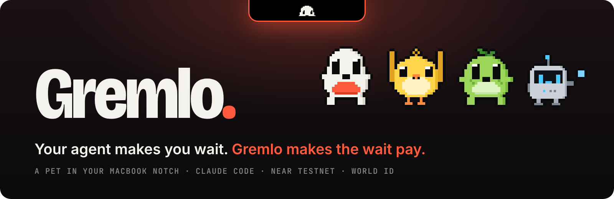</p>

<p align="center">
  <b>A tiny pet that lives behind your MacBook notch, reacts to Claude Code, and earns from one sponsored line while your agent works.</b>
</p>

<p align="center">
  <a href="#try-it-in-two-minutes">Try it</a> ·
  <a href="#how-it-works">How it works</a> ·
  <a href="#the-full-walkthrough">The full walkthrough</a> ·
  <a href="#proof">Proof</a> ·
  <a href="#whats-real">What's real</a> ·
  <a href="#run-the-full-loop-from-source">Run from source</a>
</p>

<p align="center">
  <b>Live now, no Mac needed:</b>
  <a href="https://gremlo.vercel.app">web app</a> ·
  <a href="https://gremlo.vercel.app/live">judge page (live pet, thoughts charged on chain, settlements)</a> ·
  <a href="https://gremlo.vercel.app/park">park</a> ·
  <a href="https://gremlo.vercel.app/brand?c=3">a live campaign</a> ·
  <a href="https://16-4-100-95.sslip.io/health">API health</a>
</p>

<p align="center">
  
  
  
  
  
</p>

<p align="center"><a href="https://youtu.be/g5L31kJ2dRQ">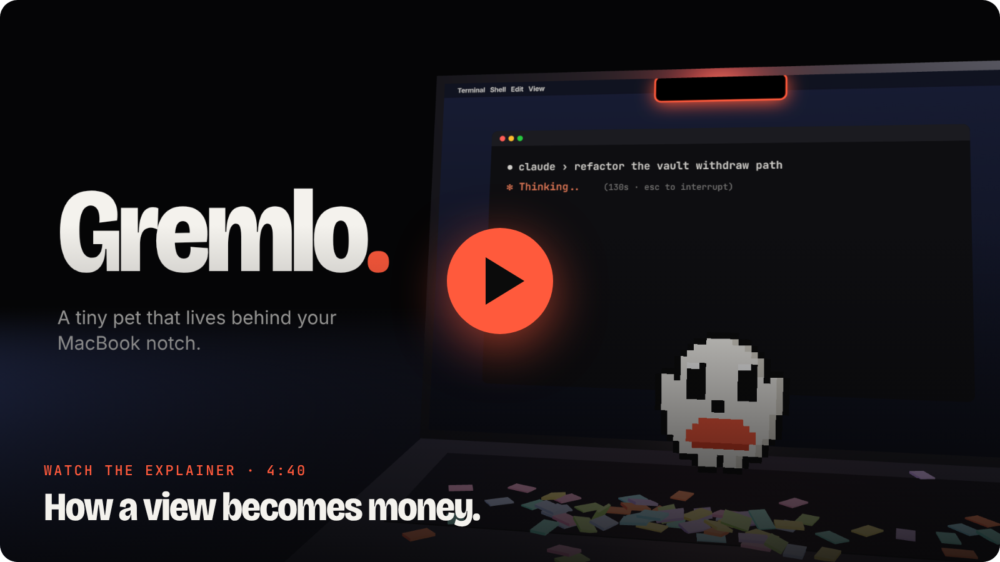</a></p>

**Judging? Verify in 2 minutes, no keys:**

1. `curl https://16-4-100-95.sslip.io/stats` shows campaigns, settled views, NEAR paid and compute charged. Compute charged is 20% of paid.
2. Open any "charged on chain" link on [/live](https://gremlo.vercel.app/live). Each is a `charge_compute` call on `vault.gremlo.testnet` carrying the NEAR AI completion id.
3. Every transaction from the final run is linked in [PROOF.md](PROOF.md), and the vault's code hash matches a `cargo near build` of `contracts-near` (Rust 1.95, pinned in `rust-toolchain.toml`).

Gremlo was built for the NEAR Hackathon (Nov 2026) and is now in active development as a product. The submission snapshot is the [`hackathon-submission`](https://github.com/DiveshK007/GREMLO/tree/hackathon-submission) tag.

## What it does

<table>
<tr>
<td width="33%" valign="top">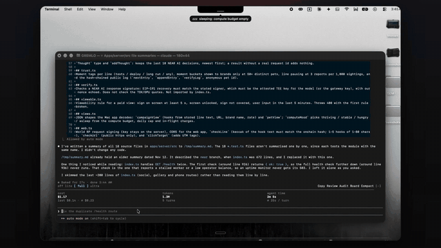<br><b>It lives in the notch.</b><br>It drops out when Claude Code starts working, knocks when the agent needs your approval, and celebrates when the run is done.</td>
<td width="33%" valign="top">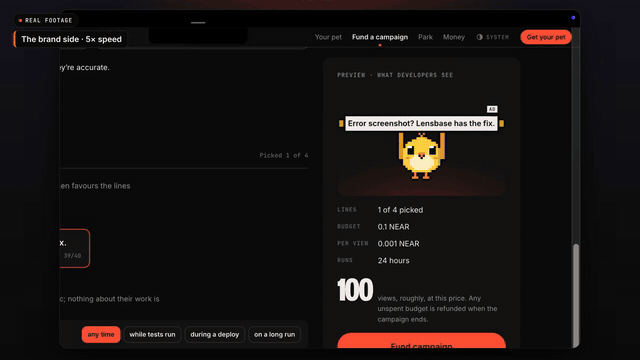<br><b>It holds one sponsored line.</b><br>A brand writes a line of 6 to 40 characters and pays into a vault from its own wallet. The line shows only while your agent works, labelled AD.</td>
<td width="33%" valign="top">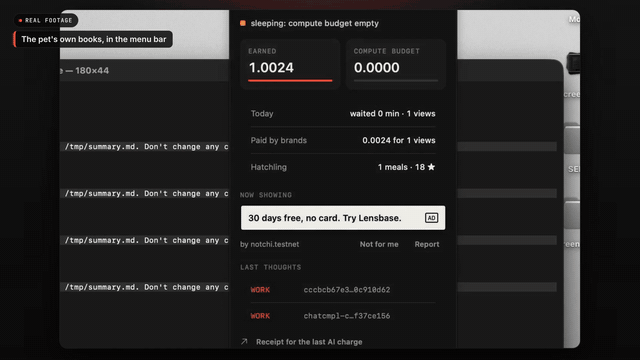<br><b>It keeps its own books.</b><br>Each verified view is settled onchain. Most goes to you; a share goes into the pet's compute budget, which its AI calls are charged against.</td>
</tr>
</table>

All three clips are real screen recordings from the final run on 15 Nov 2026.

## Try it in two minutes

You need a Mac on macOS 13 or later and the Xcode Command Line Tools (`xcode-select --install`).

```bash
curl -fsSL https://raw.githubusercontent.com/DiveshK007/GREMLO/main/install.sh | bash
```

That builds Gremlo from source on your Mac (a few minutes the first time), puts it in `~/Applications/Gremlo.app` and starts it. Then:

1. Click the Gremlo icon in the menu bar.
2. Open **Settings → General → Claude Code → Connect**.
3. Start a Claude Code run and watch the notch.

Run the same line again to update. To quit, use the bottom of the menu bar panel.

> **Hosted server:** `https://16-4-100-95.sslip.io` (NEAR testnet). Point the app at it with `GREMLO_SERVER=https://16-4-100-95.sslip.io GREMLO_WEB=https://gremlo.vercel.app` (for an app opened from Finder, use `launchctl setenv`). Without it the app talks to `http://localhost:8787`, so you can also [run the full loop yourself](#run-the-full-loop-from-source).

<details>
<summary>Why build from source, and what about a download?</summary>

There is no Apple Developer account behind Gremlo yet, so the app isn't notarized. Built on your own Mac, macOS opens it without a warning. A `.dmg` will appear under [Releases](https://github.com/DiveshK007/GREMLO/releases) when the first `v*` tag is pushed; it will be ad hoc signed, so you'll need **System Settings → Privacy & Security → Open Anyway** the first time, or `xattr -dr com.apple.quarantine /Applications/Gremlo.app`.
</details>

## How it works

<p align="center">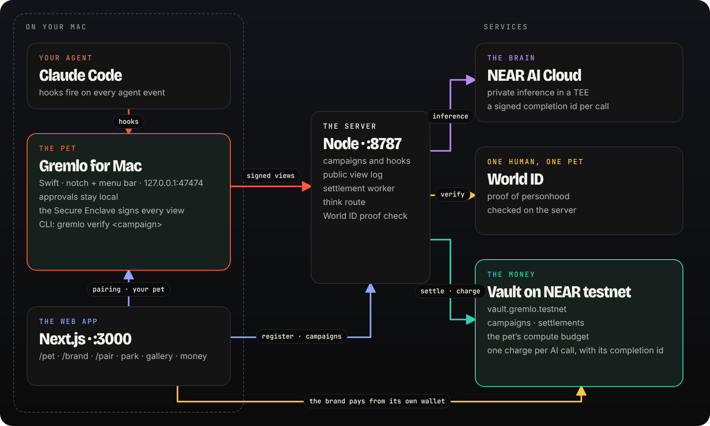</p>

<p align="center">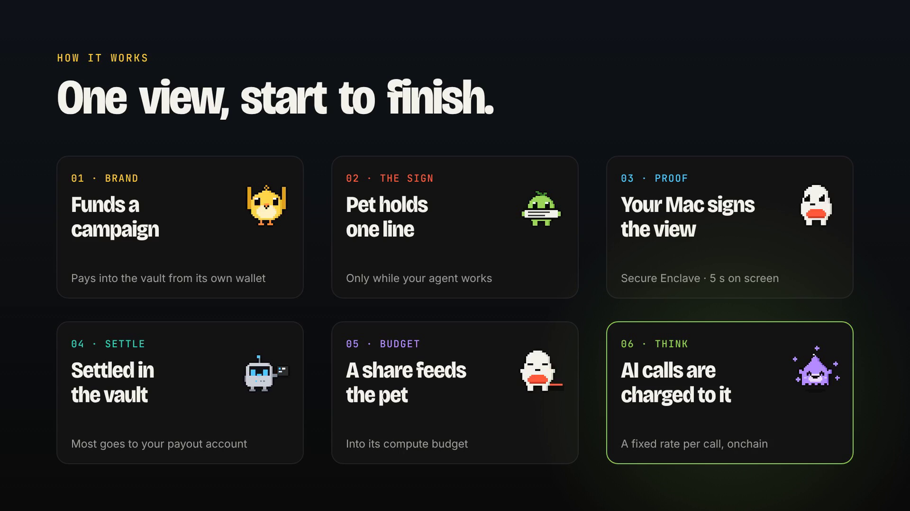</p>

1. **Get a pet.** On `/pet` you connect a NEAR wallet and prove you are a person with World ID. The server checks the proof and registers the pet in the vault with your payout account.
2. **A brand funds a campaign.** On `/brand` the brand writes up to four lines (or picks from hooks NEAR AI writes, each with its completion id) and pays into the vault from its own wallet.
3. **The pet holds the line while your agent works.** Each view is a report signed by your Mac's Secure Enclave and appended to the campaign's public log.
4. **Settlement feeds the pet.** The server settles views in the vault. Most goes to the payout account; a share goes into the pet's compute budget. Each NEAR AI call is charged a fixed per-tier rate against that budget, with the TEE-signed completion id in the log. The pet's mood follows the real budget: thriving, stable, hungry, or asleep.

### What counts as a view

<p align="center">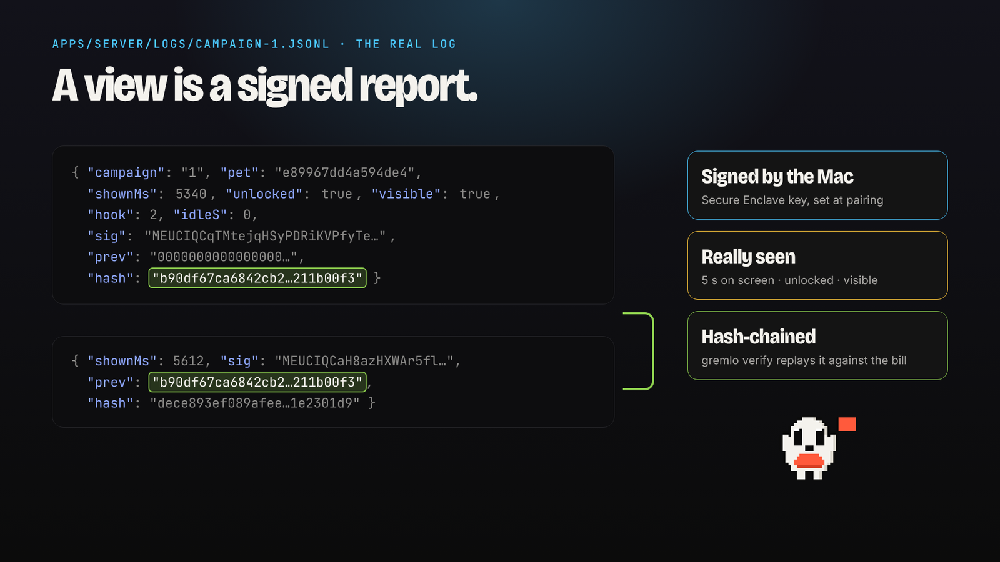</p>

A view counts only when all of these hold:

- the sign was on screen for 5 seconds;
- the screen was unlocked, not shared and not recorded;
- someone used the Mac in the last 5 minutes;
- the Mac is paired to the pet (one wallet signature on `/pair`);
- at most 12 lines an hour.

A log entry holds the campaign, which line was shown, for how long, the visible and unlocked flags, idle seconds, the pet key and the signature. `gremlo verify <campaign>` replays the log against the bill.

### Where the money goes

<p align="center">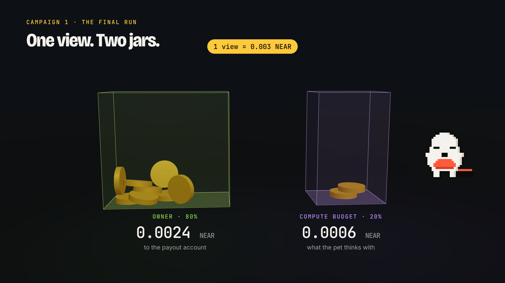</p>

In the final run each view paid 0.003 NEAR: 0.0024 to the owner's payout account and 0.0006 (the 20% compute share) into the pet's budget. A smart-model call cost 0.0005 and a cheap one 0.0001, which took the budget back to zero.

## The full walkthrough

<p align="center"><a href="https://youtu.be/-QK3U_Z1n5s">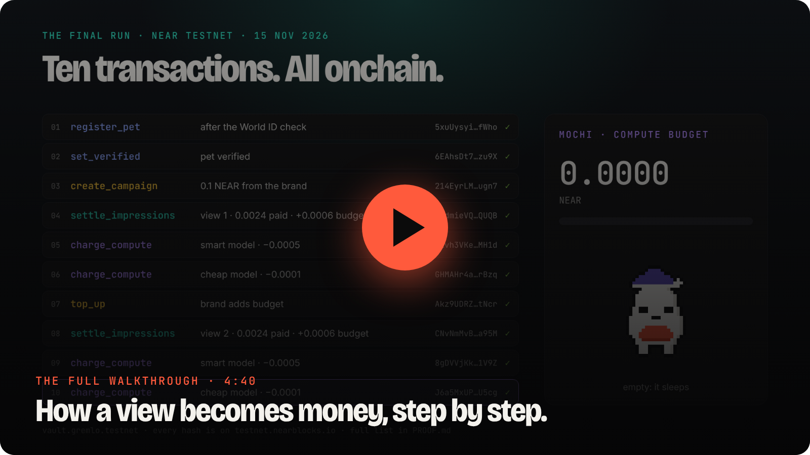</a></p>

4:40. One view from start to finish: the brand's campaign, the signed view, settlement on NEAR testnet, the compute budget, and the ten transactions from the final run.

## Proof

<p align="center">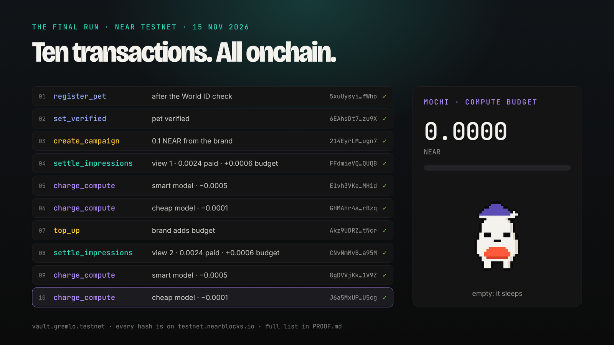</p>

The final run on `vault.gremlo.testnet`, 15 Nov 2026. Every hash was checked on testnet RPC: each ended in `SuccessValue`.

| # | What happened | Call | Tx |
|---|---|---|---|
| 1 | Pet registered after the World ID check | `register_pet` | [`5xuUysyi…fWho`](https://testnet.nearblocks.io/txns/5xuUysyigMP4bARt3WdRHTW9byCyKiifiwi4oPd8fWho) |
| 2 | Pet verified | `set_verified` | [`6EAhsDt7…zu9X`](https://testnet.nearblocks.io/txns/6EAhsDt7Ae6mqq1ipxBgP22Yra9ccWB1fSJ9sdsdzu9X) |
| 3 | Brand funds campaign 1 with 0.1 NEAR | `create_campaign` | [`214EyrLM…ugn7`](https://testnet.nearblocks.io/txns/214EyrLM5Jwqsn2R2gDbGrnBYXsKQsLnZXvCXXTougn7) |
| 4 | View 1 settled: 0.0024 NEAR paid, +0.0006 to the budget | `settle_impressions` | [`FFdmieVQ…QUQB`](https://testnet.nearblocks.io/txns/FFdmieVQ26YyJcHwkvcSnSveA4EfG6SxYUE2JwWBQUQB) |
| 5 | Smart-model call charged: 0.0005 NEAR | `charge_compute` | [`E1vh3VKe…MH1d`](https://testnet.nearblocks.io/txns/E1vh3VKeVobQJPZjC5PKcpmiTfWzoqkGurW4KhCSMH1d) |
| 6 | Cheap-model call charged: 0.0001 NEAR | `charge_compute` | [`GHMAHr4a…rBzq`](https://testnet.nearblocks.io/txns/GHMAHr4ad8hZKJf7jR9Mgz92K1wXKBh4srFTbanCrBzq) |
| 7 | Brand tops up campaign 1 | `top_up` | [`Akz9UDRZ…tNcr`](https://testnet.nearblocks.io/txns/Akz9UDRZqkSM5AjjEubTZhfv6QD7U52kjsPQ63R4tNcr) |
| 8 | View 2 settled: 0.0024 NEAR paid, +0.0006 to the budget | `settle_impressions` | [`CNvNmMvB…a95M`](https://testnet.nearblocks.io/txns/CNvNmMvBLdgdXzCUFr852CRdjRCrWb43sVLjSuoUa95M) |
| 9 | Smart-model call charged: 0.0005 NEAR | `charge_compute` | [`8gDVVjKk…1V9Z`](https://testnet.nearblocks.io/txns/8gDVVjKkHYh7VkGWpwvJ5hS7AdpYUUAAWMRVZuWj1V9Z) |
| 10 | Cheap-model call charged: 0.0001 NEAR | `charge_compute` | [`J6a5MxUP…U5cg`](https://testnet.nearblocks.io/txns/J6a5MxUP1EV5591XNVRV8i4B194hAuGnv8wW8eggU5cg) |

`npm run verify chatcmpl-cc26d4e5-abf1-4837-b10f-7543f37ce156` returns **SIGNED**: the signature recovers to `0xfe0071895500a9755c18044948ab4f4e1a7f337e`, an attested key of the NEAR TEE that served the call.

<p align="center">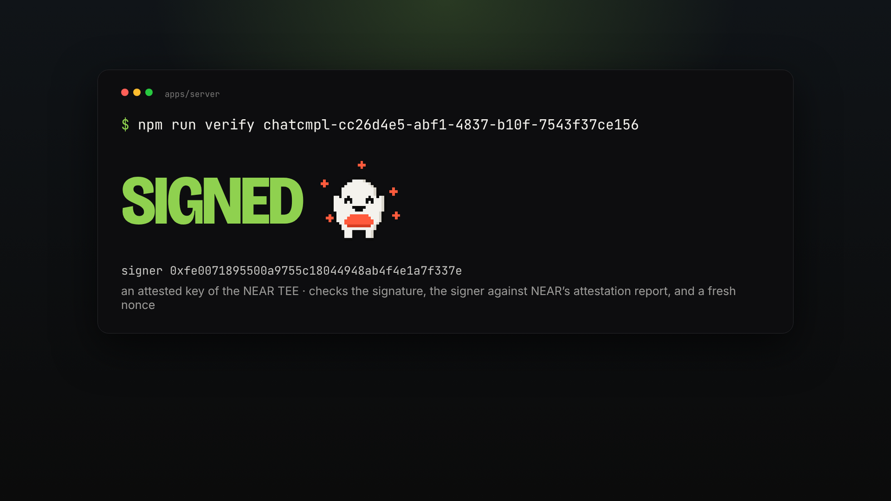</p>

Accounts, the deploy transaction, the vault state after the run and the earlier dry run are in [PROOF.md](PROOF.md).

## What's real

| | Status | Detail |
|---|---|---|
| Vault on NEAR testnet | **Live** | `vault.gremlo.testnet`, operator `operator.gremlo.testnet`; the code hash matches a local build of `contracts-near` |
| The full loop | **Live on testnet** | register, verify, fund, two views settled, four NEAR AI calls charged, each with its completion id |
| TEE-signed inference | **Live** | one completion verified with `npm run verify` |
| World ID | **Simulator** | the final run used the World ID simulator, not a real Orb or app proof |
| iPhone and Watch apps | **Simulator only** | `apps/ios` builds and launches in the simulators; signing and TestFlight need an Apple Developer account |
| The pet's own purse | **Built, not deployed** | factory and purse contracts in `contracts-accounts` (14 tests); pets use the vault's compute budget for now |
| Hosted server and website | **Live** | [gremlo.vercel.app](https://gremlo.vercel.app) on Vercel, API on AWS EC2 behind HTTPS ([/health](https://16-4-100-95.sslip.io/health)) |
| Signed Mac download | **Not yet** | build from source with the install line |
| Mainnet | **Not yet** | nothing is on mainnet |

Known limits:

- AI calls are charged at a fixed per-tier rate in NEAR, not the real USD bill, and the operator holds the NEAR AI credits. The pet can't buy credits directly yet.
- The platform fee isn't published.
- A system Focus can't be read without an Apple entitlement, and browser screen sharing isn't detected (mic and Zoom or system recording are).
- Community species can't be installed from the gallery yet.
- The notch app is macOS only. The server, web app, brain and contracts build and test on Linux and macOS; on Windows use WSL2.
- The vault account still has a full-access key held by the deployer (testnet). The mainnet plan is to lock it after deploy.

## Run the full loop from source

Needs macOS 13+ with Swift 5.9+ for the Mac app, Node 22+, and Rust 1.95 (pinned in `rust-toolchain.toml`) plus `cargo-near` 0.22 for the contracts. Everything except the Mac app also builds on Linux; the commands below are bash.

```bash
git clone https://github.com/DiveshK007/GREMLO.git && cd GREMLO

cp apps/server/.env.example apps/server/.env    # NEAR operator account and key, vault id, NEAR AI key, World app id
cp apps/web/.env.example apps/web/.env          # server URL, vault id, World app id

(cd apps/server && npm ci && npm start)         # :8787
(cd apps/web && npm ci && npm run dev)          # :3000
(cd apps/mac && swift run Gremlo)               # then menu bar → Settings → General → Claude Code → Connect
```

Then open `http://localhost:3000/pet` to get a pet, `/pair` to pair this Mac, and `/brand` to fund a campaign. Every env var name is listed in [HANDOFF.md](HANDOFF.md).

<details>
<summary>Build and test everything (no keys needed)</summary>

```bash
(cd apps/mac && swift build && swift test)                                   # Mac app + GremloCore: 114 tests
(cd apps/server && npm ci && npm test)                                       # 79 tests
(cd packages/brain && npm test)                                              # 16 tests
(cd apps/web && npm ci && npm run typecheck && npm run build && npm test)    # 4 tests
(cd contracts-near && cargo test)                                            # vault: 3 unit + 18 integration tests
(cd contracts-accounts && cargo test)                                        # factory and purse: 14 tests
```
</details>

<details>
<summary>Deploy the vault yourself</summary>

Build with `cargo near build non-reproducible-wasm` in `contracts-near`, then deploy with the near CLI. Steps are in [docs/DEPLOY.md](docs/DEPLOY.md).
</details>

## Repo map

| Part | Where |
|---|---|
| Mac app: eight species, the sign, Notch Live and approvals, growth and the Closet, bug hunt, git moods, room, focus, privacy rules, stream mode | `apps/mac` (rules and tests in `GremloCore`) |
| `gremlo` CLI, `gremlo://` links | `apps/mac/Sources/GremloCLI` |
| Server: campaigns, signed views with a public log, settlement, park, gallery | `apps/server` |
| NEAR AI calls, mood to model, claim checks | `packages/brain` |
| Web: the site and the app pages | `apps/web` |
| iPhone and Watch (simulator only) | `apps/ios` |
| VS Code and Cursor extension, Raycast extension | `apps/vscode`, `apps/raycast` |
| Vault (campaigns, compute budget) | `contracts-near` |
| Factory and purse (not deployed) | `contracts-accounts` |

## Prior art and history

[sk-ruban/notchi](https://github.com/sk-ruban/notchi) is an open-source notch companion for Claude Code. Gremlo differs by its sponsored-view economy, onchain settlement and the compute budget its AI calls are charged against.

Gremlo started at ETHGlobal Mumbai 2026 as **Notchi**, on a different stack. That build lives on the `ethglobal-0g` branch and is described in [docs/HISTORY.md](docs/HISTORY.md); nothing there describes `main`.

## Team

<!-- TODO(you): names, roles, X handles -->
Built by [@DiveshK007](https://github.com/DiveshK007).

## License

[MIT](LICENSE).

AI usage: [docs/AI_USAGE.md](docs/AI_USAGE.md).
